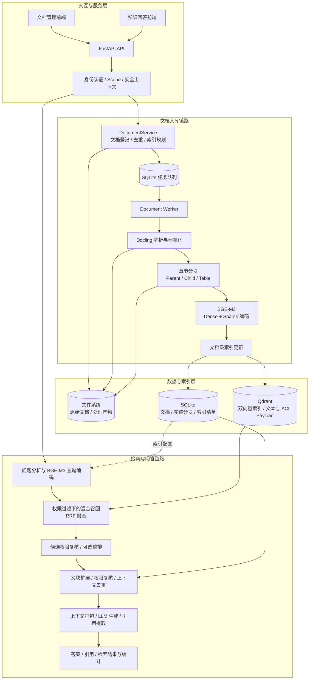

# Enterprise RAG · 企业知识库检索与问答系统

面向企业文档知识库的 RAG（Retrieval-Augmented Generation，检索增强生成）系统，覆盖文档上传、结构化解析、分层分块、混合检索、重排和带引用回答，并提供文档权限管理、持久化任务队列、上传去重、智能重索引与自动化效果评估。

项目围绕两条核心链路组织：**入库链路负责把文档转化为可检索、可治理的知识；问答链路负责在用户权限范围内召回证据、补全上下文并生成回答。** 当前主链路采用 **Docling + BGE-M3 + Qdrant + SQLite + FastAPI**。

## 已实现的功能

| 能力 | 实现内容 |
| --- | --- |
| 文档接入与解析 | 浏览器上传、本地文件接入；通过 Docling 解析并统一为文档、章节、正文元素和表格等结构；提供 PDF 解析后端与 OCR 选项 |
| 结构感知分块 | 按章节构建 Parent / Child 分块，表格独立成块；保留章节路径、来源信息、父子关系、相邻块关系和内容指纹 |
| 混合检索 | BGE-M3 同时生成 Dense / Sparse 向量，在 Qdrant 中进行双路召回与 RRF 融合，支持元数据和权限过滤 |
| 重排与上下文构建 | 接入 BGE、Qwen、Cohere、Voyage 重排器；支持跳过重排；命中子块后扩展父块，合并重复上下文 |
| 知识库问答 | 上下文长度预算、基于资料回答的提示词、引用提取、无上下文时直接拒答；接入 Ollama、OpenAI-compatible 接口及 Mock 适配器 |
| 文档治理 | 文档列表与详情、权限修改、重索引、删除、状态和索引数量展示；基于内容与权限去重，按配置指纹复用处理产物 |
| 后台任务 | SQLite 持久化任务队列、独立 Worker、任务领取、阶段进度、失败重试、取消与手动重试 |
| 身份与访问控制 | 数据库账号登录与 JWT、OIDC / JWKS 校验、接口 Scope 控制、租户 / 用户 / 用户组 ACL 和密级过滤，以及开发调试认证模式 |
| 双前端 | 管理端负责文档和任务管理；问答端提供浏览器本地会话管理、模型选择、生成参数调整和引用展示，两个前端分别保存登录状态 |
| 效果评估与追踪 | 内置评估集、评分规则和评估脚本；输出检索、答案、引用与可靠性指标；提供请求 ID 和可选审计日志 |

## 系统架构



### 入库链路：从文档到知识索引

1. **上传与登记**：保存原始文件，计算内容哈希和权限签名；命中重复文档时返回已有记录，否则创建文档和入库任务。
2. **索引规划**：Worker 领取任务后，对比文档级索引清单，判断跳过处理、复用解析结果、复用分块，或重新构建索引。
3. **解析与分块**：Docling 输出经标准化后，按章节生成较大的 Parent 块、较小的 Child 块和独立 Table 块，同时继承来源元数据与 ACL。
4. **编码与写入**：默认对 Child / Table 块进行 BGE-M3 双向量编码，更新 Qdrant 中该文档的索引记录；完整分块与索引清单保存到 SQLite。
5. **状态同步**：更新任务进度、文档状态、索引统计与集合清单；API 侧检测清单签名变化后刷新知识库运行时。

### 问答链路：从问题到可追溯回答

1. **确定访问范围**：启用权限校验时，从已认证身份构造租户、用户、用户组和密级上下文，覆盖请求体中的身份字段。
2. **分析与编码**：识别一般、表格、总结或精确查询类型，并对问题生成 Dense / Sparse 查询向量。
3. **混合召回**：两路检索均携带 ACL 和元数据条件，由 Qdrant 通过 RRF 融合结果，再进行应用层可见性复核。
4. **重排与上下文扩展**：对候选进行可选重排，再从 SQLite 获取关联父块；扩展时重新校验权限，并按上下文 ID 去重。表格命中保留表格自身内容，可附加关联章节。
5. **组织回答**：按上下文数量、单块长度和总字符预算打包证据，调用 LLM，提取回答中的 `[Context N]` 引用，返回答案、证据片段、章节路径、检索统计和警告信息。

### 存储职责

| 存储 | 保存内容 | 在链路中的作用 |
| --- | --- | --- |
| 文件系统 | 原始上传文件、解析结果、分块与索引处理产物 | 保留处理结果，供排查、复用与调试 |
| SQLite：文档与任务 | 文档元数据、ACL、状态、任务进度、尝试次数与错误信息 | 管理文档生命周期和后台作业 |
| SQLite：Chunk Repository | 包含 Parent / Child / Table 的完整分块 | 为检索命中提供父块扩展和原始分块查询 |
| SQLite：索引清单 | 集合级向量配置、文档级内容与配置签名、索引版本 | 为运行时提供索引配置，并判断文档是否需要重建 |
| SQLite：认证数据 | 用户、密码哈希、租户、用户组、角色与 Scope | 为本地账号认证提供身份和权限信息 |
| Qdrant | Dense / Sparse 向量、检索块文本、元数据与 ACL Payload | 执行混合召回、过滤及文档级索引更新 |

在线检索直接使用 Qdrant 和 SQLite；正常入库按文档更新索引与清单。集合级 JSON 合并保留为显式调试 / 导出能力。

## 核心设计与亮点

### 1. 用小块检索，用父块补全语境

分块保留文档的章节结构，分别承担检索和上下文组织职责：

- **Child 块**用于定位具体内容，默认与 Table 块一起进入向量索引。
- **Parent 块**保存更完整的章节语境，命中子块后再从 SQLite 取回。
- **Table 块**独立保存表格 Markdown、行信息和章节关联，构建上下文时保留表格内容。
- **上下文前缀**把文档名、来源、章节路径等信息加入待编码文本；内容哈希与来源关系贯穿后续处理。

这一设计让检索粒度和回答上下文长度可以分别控制，同一父块下的多个命中也能合并为一份上下文。

### 2. 同一编码模型支撑语义与词项双路检索

BGE-M3 同时提供 Dense 向量和基于词项权重的 Sparse 向量，分别承担语义匹配和词项匹配；文档与问题使用一致的编码方式，双向量存入同一 Qdrant 集合，并由 RRF 融合候选排序。

召回、融合、重排和最终上下文数量分别可控。重排层通过统一接口接入本地 BGE / Qwen 或远程 Cohere / Voyage，默认 `noop` 保留融合排序，便于独立比较各环节的效果。

### 3. 权限约束贯穿召回与上下文扩展

访问控制同时覆盖接口权限和内容可见性：

- **接口层**：JWT / OIDC 解析身份，通过 Scope 控制问答、检索、模型查询和文档管理能力。
- **索引层**：把文档 ACL 编码到分块元数据和 Qdrant Payload，用户与用户组标识支持租户作用域。
- **召回层**：在 Dense / Sparse 两路预取时加入主体匹配、密级上限和元数据过滤。
- **上下文层**：对召回记录和扩展取得的父块再次检查可见性，再交给回答层。

已就绪文档的权限修改会同步更新分块、Qdrant Payload 和文档索引清单中的权限签名，无需为这类修改重新计算向量。

### 4. 将上传去重与索引复用分开处理

**上传去重**使用“内容哈希 + 权限签名”生成去重键。相同内容、相同访问范围的重复上传复用已有文档记录；访问范围不同的文档分别登记，保留各自的权限语义。

**智能重索引**进一步比较内容、解析配置、分块配置、Embedding 配置、权限签名和索引版本：

| 判断结果 | 处理策略 |
| --- | --- |
| 所有签名与版本一致，文档就绪且已有索引和分块记录 | 跳过重复处理 |
| 内容或解析配置变化 | 重新解析、分块并构建索引 |
| 仅分块配置变化 | 复用解析结果，重新分块并构建索引 |
| 仅 Embedding 配置或索引版本变化 | 复用解析与分块产物，重新编码并构建索引 |

复用以对应产物实际存在为前提。重建以文档为单位替换该文档的索引记录，并通过索引版本表达需要统一重建的语义变化。

### 5. 让文档处理成为可管理的后台任务

上传和重索引请求创建持久化任务，由独立 Worker 执行解析、分块与索引工作。任务的**状态**和**处理阶段**分别记录：

```text
任务状态：queued → running → succeeded
                    ├─→ retrying → running（未超过最大尝试次数）
                    ├─→ failed（重试耗尽）
                    └─→ cancelling → cancelled（运行中请求取消）
          queued / retrying → cancelled（执行前取消）

处理阶段：parsing → chunking → embedding → indexing
          → rebuilding_collection（同步分块与索引清单）→ completed
```

任务通过带状态条件的数据库更新领取，记录 Worker、尝试次数、进度、心跳时间和错误信息。失败支持延迟重试，失败或已取消的任务支持手动重试；运行中取消在处理阶段边界检查。已有解析与分块产物可在后续处理时复用。

### 6. 回答保留证据，评估覆盖整条链路

回答层限制上下文长度，并通过提示词要求基于资料作答、为关键结论添加引用。没有可用上下文时直接返回资料不足；模型回答未包含有效上下文引用时返回警告。引用结果保留上下文 ID、源分块 ID、父块 ID、章节路径和证据摘录，便于追踪回答依据。

内置的评估集包含 **32 道题：30 道可回答问题和 2 道拒答问题**。每题包含预期答案要点、证据及评分权重，评估脚本既可请求 API，也可对保存的结果重新评分，并支持启发式评分与可选 LLM Judge。

| 评估维度 | 已实现的指标与分析 |
| --- | --- |
| 检索质量 | Recall@3/5/10、MRR@10、nDCG@10、ContextPrecision@5、章节命中率 |
| 答案质量 | 预期要点覆盖率、按题型和难度分组评分 |
| 引用质量 | 引用精确率、召回率与证据支持率 |
| 可靠性 | 无依据陈述检查、拒答准确率、失败原因分布与低分样本 |

评估输出包括逐题结果、逐题评分、JSON 汇总和 Markdown 报告。相关资源：[评估数据集](eval/datasets/xh202609_rag_eval.json)、[数据集说明](eval/datasets/xh202609_dataset_card.md)、[评分规则](eval/rubrics/rag_score_v1.md)、[评估脚本](scripts/evaluate_rag.py)。

## 工程结构

```text
app/
├── api/          # FastAPI 接口、请求响应模型与 RAG 运行时装配
├── security/     # 账号认证、JWT / OIDC、Scope 校验与审计日志
├── domain/       # 文档领域模型与统一权限语义
├── connectors/   # 本地文件发现、文件元数据与接入权限
├── ingestion/    # 文档解析流程编排
├── parsing/      # Docling 适配与文档标准化
├── chunking/     # 结构感知分块、表格分块与上下文前缀
├── documents/    # 文档服务、任务队列、分块仓库、指纹与索引清单
├── indexing/     # BGE-M3 编码、批量索引与 Qdrant 适配
├── retrieval/    # 查询分析、混合召回、重排、父块扩展与上下文构建
└── answering/    # 上下文打包、提示词、LLM 适配与引用提取
frontend/         # 管理端、问答端及各自的登录页面
scripts/          # 文档 Worker、效果评估与解析 / 分块 / 回答调试工具
eval/             # 评估数据集、评分规则与报告模板
tests/            # 分层单元测试与 Docling 解析集成测试
```

核心流程由领域模型和适配器接口连接。测试覆盖解析标准化、父子与表格分块、双向量索引、权限过滤、父块扩展、引用提取、认证、文档去重、索引复用和任务管理；多数单元测试使用 BGE / Qdrant 替身验证流程逻辑。

## 技术栈

| 层次 | 技术与实现 |
| --- | --- |
| 语言与数据模型 | Python 3.11+、Pydantic 2 |
| API 服务 | FastAPI |
| 文档解析 | Docling |
| 向量编码 | BGE-M3 / FlagEmbedding |
| 检索引擎 | Qdrant Dense + Sparse、RRF |
| 元数据与任务存储 | SQLite |
| 可选重排 | BGE、Qwen、Cohere、Voyage |
| 回答模型接口 | Ollama、OpenAI-compatible、Mock |
| 身份认证 | 数据库账号、JWT、OIDC / JWKS |
| 前端 | HTML、CSS、原生 JavaScript |
